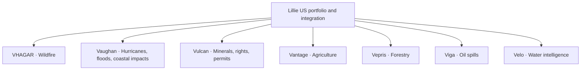

# Lillie US

Southern US satellite-intelligence portfolio and integration hub. Each product has an independent repository linked back to this hub. The portfolio combines existing research code with clearly labelled design-stage products; it is not yet a unified deployed platform.

## Product portfolio

| Product | Sector and responsibility | Current status | Hub integration |
|---|---|---|---|
| [VHAGAR](https://github.com/Ibekwemmanuel7/VHAGAR) | Wildfire intelligence | Research code; Southern validation separate | Pinned Python dependency |
| [Vaughan](https://github.com/Ibekwemmanuel7/vaughan) | Hurricanes, flood and coastal impacts | Hurricane research; flood/coastal expansion planned | Pinned Python dependency |
| [Vulcan](https://github.com/Ibekwemmanuel7/Vulcan) | Mineral prospectivity, mineral rights and permits | Prospectivity research; rights/permits expansion planned | Pinned Git submodule |
| [Vantage](https://github.com/Ibekwemmanuel7/Vantage) | Southern US agriculture | Initial market and scope designed | Documentation reference only |
| [Vepris](https://github.com/Ibekwemmanuel7/Vepris) | Southern US forestry | Scope designed | Documentation reference only |
| [Viga](https://github.com/Ibekwemmanuel7/Viga) | Oil-spill detection | Awaiting owner-led code separation | Documentation reference only |
| [Velo](https://github.com/Ibekwemmanuel7/Velo) | Water intelligence | Scope designed | Documentation reference only |




Vaughan owns event flooding and coastal impacts; Velo owns ongoing water-resource and water-quality context. Vulcan's new rights/permit scope requires records and specialist review in addition to imagery. Those extensions are roadmaps, not newly implemented capabilities. Viga's separation from LillieWatch remains owner-led.

## Navigate the portfolio

- [Responsibilities and product status](docs/PORTFOLIO.md)
- [Repository and integration strategy](docs/REPOSITORY_STRATEGY.md)
- [Proposed cross-product interfaces](docs/INTERFACES.md)
- [Machine-readable product catalogue](portfolio.json)
- [Source and documentation references](source-pins.json)

## Repository arrangement

Keep seven independent product repositories. Use commit-pinned Python dependencies for packaged code and a submodule where a source checkout is actually needed. Design-stage products remain linked references until there is code to integrate. Every product's README points here; a backlink is not a circular application dependency.

Current tracked structure:

```text
Lillie_US/
  README.md                  Portfolio entry point
  portfolio.json             Products, domains, status and reviewed revisions
  source-pins.json           Installed code pins and documentation references
  pyproject.toml             VHAGAR and Vaughan Python dependencies
  .gitmodules                Vulcan submodule URL and path
  docs/                      Portfolio, repository strategy and interfaces
  scripts/validate_portfolio.py
  modules/ml_mineral/        Vulcan at the recorded commit
```

## Get the source checkout

```powershell
git clone --recurse-submodules https://github.com/Ibekwemmanuel7/Lillie_US.git
cd Lillie_US
```

For an existing checkout, after pulling the parent revision:

```powershell
git submodule update --init --recursive
```

This checks out Vulcan at the recorded commit. It does not automatically clone all design-stage repositories or run their code.

## Python integration

Requires Python 3.11 or later and Git. Create and activate a virtual environment, then install the integration metadata and its two Python dependencies:

```powershell
python -m venv .venv
.\.venv\Scripts\Activate.ps1
python -m pip install .
```

Vaughan pulls scientific dependencies including PyTorch. VHAGAR's optional geospatial, archive and serving extras must be selected when their workflows are implemented. Vulcan uses its own environment and [setup instructions](modules/ml_mineral/README.md); it is not installed by `pip install .`.

Runtime source pins remain VHAGAR `42ffa5afeb6d358108a3c4d1f962d9b8747ae3af` and Vaughan `095374d4e74fa7c6125165460599b9270f21ece7`. Portfolio-documentation revisions are recorded separately so scope changes do not silently change scientific code versions. Transitive dependencies are not locked by these source pins.

## Validate and update

```powershell
python scripts/validate_portfolio.py
```

Review and test code changes in their owning product first, publish the product commit, then update the corresponding parent package pin or submodule pointer together with the registry. Never substitute a moving branch for a source pin. For documentation-only products, record the reviewed documentation commit without claiming an installed runtime capability.

Original local research folders and unpublished planning documents remain separate. This organisation change does not copy customer datasets, deploy services, or establish Southern US model performance.
